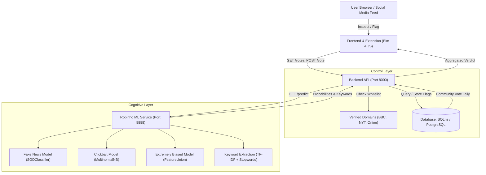

# The Fake News Detector

[](https://circleci.com/gh/fake-news-detector/fake-news-detector)
[](https://www.python.org/)
[](https://scikit-learn.org/)
[](https://elm-lang.org/)
[](https://opensource.org/licenses/MIT)

**The Fake News Detector** is an open-source, crowdsourced, and machine learning-powered defense platform that detects and flags online news stories into:
- 🟢 **Legitimate** (Verified journalistic reporting)
- 🔴 **Fake News** (Fabricated or deceptive claims)
- 🟡 **Click Bait** (Sensationalized titles withholding crucial context)
- 🟠 **Extremely Biased** (Heavy ideological skew or emotional manipulation)
- 🟣 **Satire** (Parody, humor, and comedy news)
- ⚪ **Not News** (Personal posts, memes, or non-journalistic content)

> 📖 **Want to understand the inner journey of a news story?** Read our narrative guide in [**`how it works.md`**](how%20it%20works.md).

---

## 1. System Architecture

The project operates through a cooperative synergy between **Human Crowdsourcing** and **Artificial Intelligence (Robinho)**:



---

## 2. Core Logics & Machine Learning Pipeline

Our machine learning robot, **Robinho**, combines natural language processing (NLP) with trained statistical classifiers to evaluate unseen news stories:

1. **Fake News Classifier (`robinho/classifiers/fake_news.py`)**:
   - Uses an n-gram TF-IDF vectorizer (ranges 1 to 3 words) with ASCII accent stripping.
   - Balances data imbalances using `RandomUnderSampler`.
   - Fits a linear Stochastic Gradient Descent model (`SGDClassifier`) with modified log-loss to output calibrated probabilities.

2. **Clickbait Classifier (`robinho/classifiers/click_bait.py`)**:
   - Analyzes headline syntax patterns using a `MultinomialNB` (Multinomial Naive Bayes) model.
   - Trained on datasets from BuzzFeed and Paranjape (32,000+ headlines).

3. **Extremely Biased Classifier (`robinho/classifiers/extremely_biased.py`)**:
   - Employs a `FeatureUnion` that evaluates headline n-grams (weight: 0.5) simultaneously with body content n-grams (weight: 1.0).
   - Identifies emotionally manipulative language and subjective vocabulary.

4. **Fact-Check Keyword Extraction (`robinho/classifiers/keywords.py`)**:
   - Filters text through multilingual stop-word dictionaries (English, Spanish, Portuguese).
   - Isolates the top 8 distinct topical keywords and formats them into one-click Google Fact-Check queries.

5. **Verified Domain Overrides (`api/src/data/verified_domains.rs`)**:
   - Outlets like `bbc.co.uk`, `nytimes.com`, and `g1.globo.com` are recognized as verified legitimate sources.
   - Outlets like `theonion.com` and `sensacionalista.com.br` are tagged as satire sources.

---

## 3. Tech Stack

| Component | Technology | Description |
| :--- | :--- | :--- |
| **Machine Learning** | Python 3.8, `scikit-learn 0.24`, `imbalanced-learn 0.7` | Model pipelines, SGD, Naive Bayes, sampling |
| **Natural Language Processing** | `NLTK`, `TF-IDF`, `langdetect` | Multilingual stopwords, text vectorization |
| **ML Daemon** | Python `Tornado` | Asynchronous microservice on port `8888` |
| **Backend API** | Python `Tornado` / Rust `Rocket` | REST API, database access, and CORS headers on port `8000` |
| **Database** | SQLite (`fakenews.db`) / PostgreSQL | Persists links, categories, and deduplicated votes |
| **Frontend & Extension** | Elm `0.19`, JavaScript (ES6), Webpack | Strongly-typed, crash-free UI and timeline injectors |

---

## 4. How to Run the Project

### Option A: Local Run (Recommended)

#### Step 1: Set up the Python Environment
Ensure Python is installed (Python 3.8 is recommended for compatibility with scikit-learn models). You can create an environment using `uv` or standard `python -m venv`:

```bash
# Using uv (fastest)
uv venv robinho/.venv --python 3.8
uv pip install -r robinho/requirements.txt --python robinho/.venv/Scripts/python.exe
robinho/.venv/Scripts/python.exe -m nltk.downloader stopwords

# Or using standard python venv:
cd robinho
python -m venv .venv
source .venv/bin/activate  # On Windows: .venv\Scripts\activate
pip install -r requirements.txt
python -m nltk.downloader stopwords
```

#### Step 2: Start the Robinho Machine Learning Daemon
In your first terminal, launch Robinho on port **`8888`**:

```bash
cd robinho
../robinho/.venv/Scripts/python.exe __main__.py --server
```
*Robinho will load or train the serialized pickle models in `output/` and listen at `http://localhost:8888`.*

#### Step 3: Start the API Backend & Frontend Web App
In your second terminal, start the API and Frontend server on port **`8000`**:

```bash
robinho/.venv/Scripts/python.exe api/server.py
```
*The API and Frontend will be live at **`http://localhost:8000/`**.*

#### Step 4: Open in Your Browser
Navigate to:
👉 **[http://localhost:8000/](http://localhost:8000/)**

From the dashboard you can:
- Paste any news headline, URL, or excerpt to run live predictions.
- Click **"Load Sample Hoax"** or **"Load Verified News"** for immediate demonstration.
- View real-time probability gauges for *Fake News*, *Bias*, and *Clickbait*.
- Click extracted keywords to launch fact-checks directly on Google.
- Cast community votes to train and update the link registry.

---

### Option B: Running with Docker

If you have Docker and Docker Compose installed:

```bash
# 1. Start the API & PostgreSQL database
cd api
docker-compose up

# 2. Build and run the Robinho ML container
cd ../robinho
make build
make run
```

---

## 5. API Reference

All endpoints support CORS and return JSON:

### 1. Healthcheck
`GET /healthcheck`
```
Response: "OK"
```

### 2. List Categories
`GET /categories`
```json
[
  { "id": 1, "name": "Real News" },
  { "id": 2, "name": "Fake News" },
  { "id": 3, "name": "Click Bait" },
  { "id": 4, "name": "Extremely Biased" },
  { "id": 5, "name": "Satire" },
  { "id": 6, "name": "Not News" }
]
```

### 3. Retrieve Votes & AI Predictions
`GET /votes?url={url}&title={title}&content={content}`
```json
{
  "domain": null,
  "robot": {
    "fake_news": 0.272,
    "extremely_biased": 0.486,
    "clickbait": 0.286
  },
  "people": {
    "content": [
      { "category_id": 2, "count": 1 }
    ],
    "title": {
      "clickbait": true,
      "count": 1
    }
  },
  "keywords": ["shocking", "documents", "secret", "landing", "alien"]
}
```

### 4. Cast a Vote
`POST /vote`
```json
// Request Body
{
  "uuid": "user_12345",
  "url": "https://example.com/story",
  "title": "Shocking discovery",
  "category_id": 2,
  "clickbait_title": true
}

// Response
{
  "link_id": 3,
  "category_id": 2,
  "uuid": "user_12345",
  "ip": "127.0.0.1"
}
```

### 5. Robinho Direct Prediction Endpoint
`GET http://localhost:8888/predict?title={title}&content={content}&url={url}`
```json
{
  "predictions": {
    "fake_news": 0.27,
    "extremely_biased": 0.52,
    "clickbait": 0.23
  },
  "keywords": ["aliens", "secret", "shocking"]
}
```

---

## 6. Subprojects Directory

| Subproject | Description | Documentation |
| :--- | :--- | :--- |
| [**`/robinho`**](robinho) | Machine Learning models, training datasets, and prediction endpoint (Python). | [README](robinho/README.md) |
| [**`/api`**](api) | REST API, database models, verified domains, and admin endpoints (Rust / Python). | [README](api/README.md) \| [CONTRIBUTING](api/CONTRIBUTING.md) |
| [**`/extension`**](extension) | WebExtension injecting badges and flagging popups into Twitter & Facebook feeds (Elm & JS). | [README](extension/README.md) \| [CONTRIBUTING](extension/CONTRIBUTING.md) |
| [**`/site`**](site) | Public website enabling users to inspect and flag news without the extension (Elm). | [README](site/README.md) |

---

## 7. Running Tests

To run the Robinho unit tests:
```bash
cd robinho
../robinho/.venv/Scripts/python.exe -m unittest
```

---

## 8. Contributing

Contributions are always welcome! You can help by:
- Adding verified news domains to [`api/src/data/verified_domains.rs`](api/src/data/verified_domains.rs).
- Improving NLP pipelines and classification models in [`robinho/robinho/classifiers/`](robinho/robinho/classifiers/).
- Enhancing Elm UI components in [`extension/`](extension/) and [`site/`](site/).
- Submitting bug reports and feature requests via GitHub Issues.

### Credits
- The extension icon was created by Leif Michelsen for The Noun Project.
- The Robinho baby robot mascot photo by Drew Tetz.
- Created by Rogério Chaves and the open-source community.
