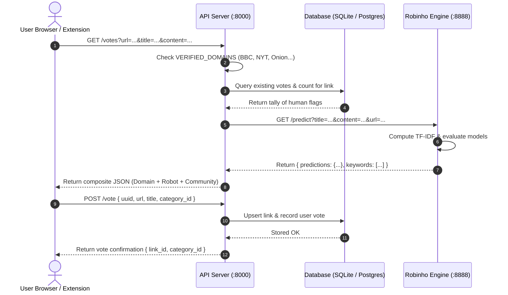

# How It Works: The Story of The Fake News Detector

> *"A tale of two intelligences: how human wisdom and robot vigilance unite to safeguard the truth."*

---

## 1. The Story: The Journey of a News Story

Imagine waking up in the morning, opening your social media feed, and stumbling across an alarming headline:

> *"SHOCKING: Secret Government Documents Reveal Alien Spacecraft Landing Concealed in Underground Bunker!"*

Your heart beats a little faster. You wonder: *Is this real? Is it a satirical parody? Is someone trying to deceive the public, or is it simply an outrageous piece of clickbait designed to harvest advertising revenue?*

In the digital world of the **Fake News Detector**, this headline does not simply sit passively on your screen. The moment it appears, an invisible cooperative dance begins between **Human Intelligence** and an artificial intelligence robot named **Robinho**.

```
    [ User's Feed / Browser ]
                │
                ▼
      ┌──────────────────┐
      │  Extension / UI  │  (Elm & JavaScript)
      └─────────┬────────┘
                │  1. Sends headline & URL
                ▼
      ┌──────────────────┐
      │   Backend API    │  (Port 8000: Routes, Auth, Database)
      └────┬────────┬────┘
           │        │
 2. Checks │        │ 3. Asks for AI Prediction
 Verified  │        │
 Domains   │        ▼
           │  ┌──────────────────┐
           │  │   Robinho ML     │  (Port 8888: scikit-learn & TF-IDF)
           │  └────────┬─────────┘
           │           │  4. Returns: Fake News %, Biased %,
           │           │     Clickbait % & Search Keywords
           ▼           ▼
      ┌──────────────────┐
      │ Database / Votes │  5. Combines Human Votes + Robot Scores
      └─────────┬────────┘
                │
                ▼
      ┌──────────────────┐
      │  User's Screen   │  6. Shows Badges, Probabilities, & Fact-Check Links
      └──────────────────┘
```

### Chapter I: The Gatekeeper (The Frontend & Extension)
As you scroll past the post, the **Fake News Detector WebExtension** (written in Elm and JavaScript) or the **Web Application** observes the DOM elements. It identifies the link (`http://fakenewsportal.net/secret-aliens`) and headline text.

Instead of judging the content on its own, the frontend dispatches an asynchronous query to the backend:
`GET /votes?url=http://fakenewsportal.net/secret-aliens&title=Shocking+Secret+Documents...`

### Chapter II: The City Clerk (The Backend API)
The query arrives at the **API Server**. The API is the coordinator, the registrar that holds community memory and historical votes. 

1. **Domain Verification**: Before asking any complex questions, the API looks at the domain. Is it an undisputed, vetted news organization like `bbc.co.uk`, `nytimes.com`, or `g1.globo.com`? Or is it a known comedy satire site like `theonion.com` or `sensacionalista.com.br`? If the domain is recognized, a verified tag is instantly attached.
2. **Community Memory**: The API queries its database (`fakenews.db` or PostgreSQL) to see if fellow humans have already flagged this exact link. It tallies how many people voted it as *Fake News*, *Clickbait*, *Extremely Biased*, or *Legitimate*.
3. **Summoning the Robot**: If this is a fresh piece of news that no human has flagged before, the API forwards the text across the local wire to port 8888, where **Robinho** lives.

### Chapter III: Inside Robinho's Neural Workshop (Machine Learning)
Robinho is an AI trained on thousands of flagged articles in English, Portuguese, and Spanish. Robinho does not read like a human reads; he dissects the text into mathematical fingerprints:

1. **Language Detection**: Robinho first checks what language the article is written in (`en`, `pt`, or `es`).
2. **N-Gram Tokenization & TF-IDF**: Robinho breaks down sentences into individual words and tuples of 2 to 3 consecutive words (*n-grams*). He transforms words into frequency matrices using **TF-IDF (Term Frequency-Inverse Document Frequency)**, identifying sensationalism, emotional manipulation patterns, and clickbait syntax.
3. **The Council of Classifiers**:
   - **The Fake News Classifier** evaluates deceptive and unverified linguistic styles using a stochastic gradient descent model (`SGDClassifier`).
   - **The Biased News Classifier** weighs headline words against body paragraph text using a `FeatureUnion` pipeline to detect strong political or emotional skew.
   - **The Clickbait Classifier** uses a Multinomial Naive Bayes model trained specifically on headlines from BuzzFeed and Paranjape datasets to assess whether the title leaves out vital context merely to bait clicks.
   - **The Keyword Hunter** strips away multilingual stop words to isolate the core factual claims (e.g., `"aliens"`, `"secret bunker"`, `"spacecraft"`).

Robinho bundles his conclusions into a tidy JSON response:
```json
{
  "predictions": {
    "fake_news": 0.82,
    "extremely_biased": 0.65,
    "clickbait": 0.89
  },
  "keywords": ["aliens", "secret documents", "spacecraft", "underground bunker"]
}
```

### Chapter IV: The Feedback Loop (The Return to the Human)
The API blends Robinho’s predictions with the community votes and delivers the result back to your browser within milliseconds:

- A colored warning pill appears beside the news item: **"High Fake News Probability (82%)"** and **"Clickbait (89%)"**.
- Below the story, a string of search chips appears: clicking any chip launches a targeted Google Fact-Check query (`aliens secret documents fact check`) so you can independently verify the claim.
- You are invited to cast your own vote: *Real News, Fake News, Clickbait, Extremely Biased, Satire, or Not News*.

When you click **"Fake News"**, your vote is committed to the database. The next person who browses past that story will see your warning. And when Robinho is retrained tonight, your vote becomes part of the training set (`train_data/links.csv`), teaching him to spot similar falsehoods faster tomorrow.

Humans protect robots from being fooled; robots protect humans from being manipulated.

---

## 2. Explaining the Whole Project at Once

If you had to summarize the entire Fake News Detector in a single sentence:

> **The Fake News Detector is a crowdsourced and AI-powered defense system that detects, classifies, and alerts internet users to deceptive news stories directly in their feeds.**

### The Three Core Pillars

```
┌────────────────────────────────────────────────────────────────────────┐
│                        THE FAKE NEWS DETECTOR                          │
├─────────────────────────┬────────────────────────┬─────────────────────┤
│   1. SENSORY LAYER      │   2. CONTROL LAYER     │ 3. COGNITIVE LAYER  │
│      (Frontend)         │       (Backend)        │       (Robinho)     │
├─────────────────────────┼────────────────────────┼─────────────────────┤
│ • WebExtension (Elm/JS) │ • REST API Server      │ • scikit-learn ML   │
│ • Web App (site/)       │ • SQLite / PostgreSQL  │ • SGD & Naive Bayes │
│ • Injects badges into   │ • Tracks link tallies  │ • TF-IDF Vectorizers│
│   Twitter & Facebook    │ • Handles voting logic │ • Multilingual NLP  │
│ • Collects user votes   │ • Verified domain list │ • Extracts keywords │
└─────────────────────────┴────────────────────────┴─────────────────────┘
```

1. **The Sensory Layer (Frontend & Extension)**:
   Lives where the user lives. Uses Elm for robust, crash-free UI state management, and JavaScript for injecting overlay widgets into social media timelines and web pages.
2. **The Control Layer (Backend API)**:
   The authoritative hub. Stores community votes, tracks user UUIDs to prevent spamming, checks verified news domains, orchestrates communication with the ML engine, and exposes REST endpoints.
3. **The Cognitive Layer (Robinho ML)**:
   The text classification brain. Trains machine learning models on news corpora and runs live inference to predict the likelihood of fake news, bias, and clickbait, while extracting fact-checking search keywords.

---

## 3. How the Backend Works Under the Hood

The backend operates on a coordinated dual-server architecture:



### The Database Architecture
The backend tracks three primary entities:
1. **`categories`**: Defines the six standard classifications:
   - `1`: Real News
   - `2`: Fake News
   - `3`: Click Bait
   - `4`: Extremely Biased
   - `5`: Satire
   - `6`: Not News
2. **`links`**: Unique registry of every URL or content hash submitted. Stores verified domain overrides, human flag counts, and extracted titles.
3. **`votes`**: Individual human actions. Uses a compound unique constraint `(link_id, uuid)` to guarantee that one person cannot cast multiple duplicate votes on the same story.

### Verified Domain Fast-Path
Before doing any heavy computation, `get_verified_domain()` extracts the hostname from the URL:
- Reputable journalists (`bbc.co.uk`, `nytimes.com`, `theguardian.com`, `g1.globo.com`) are immediately marked with `category_id: 1` (*Real News*).
- Known comedy/parody outlets (`theonion.com`, `sensacionalista.com.br`) are marked with `category_id: 5` (*Satire*).
- Unknown blogs, social media posts, and unverified news portals continue into the machine learning pipeline.

---

## 4. What File Does What: Detailed Repository Blueprint

### Root Directory
- [**`README.md`**](file:///c:/Users/Kartik/OneDrive/Documents/Desktop/JU/fake-news-detector/README.md): Main project manual containing architecture overview, quickstart commands, API contracts, and guides.
- [**`how it works.md`**](file:///c:/Users/Kartik/OneDrive/Documents/Desktop/JU/fake-news-detector/how%20it%20works.md): This file—the narrative, architectural deep-dive, and codebase map.

---

### `/robinho` (Machine Learning Engine)
The Python machine learning pipeline that trains models and exposes predictions.

```
robinho/
├── __main__.py               # CLI entrypoint: --server, --retrain, or terminal mode
├── requirements.txt          # Python dependencies (scikit-learn, tornado, pandas, etc.)
├── Dockerfile                # Docker container recipe for Robinho
├── Makefile                  # Helper commands: retrain, run, test
├── output/                   # Serialized trained model pickles (.pkl)
│   ├── fake_news.pkl         # Trained SGD model for fake news
│   ├── click_bait.pkl        # Trained Naive Bayes model for clickbait
│   ├── extremely_biased.pkl  # Trained FeatureUnion SGD model for bias
│   └── keywords.pkl          # Trained TF-IDF vectorizer for keywords
├── train_data/               # Training datasets
│   ├── links.csv             # 15.5MB dataset of flagged articles with labels
│   ├── buzzfeedbr/           # Brazilian clickbait / non-clickbait titles
│   └── bhargaviparanjape/    # English clickbait dataset (32,000 headlines)
├── tests/                    # Unit test suite verifying classifier accuracy
└── robinho/                  # Python source package
    ├── model.py              # Robinho coordinator class: trains and predicts
    ├── server.py             # Tornado HTTP server (:8888) serving /predict & /healthcheck
    ├── categories.py         # Category ID mappings
    ├── marisa_vectorizers.py # Succinct memory-efficient TF-IDF vectorizer
    ├── utils.py              # Helper functions (RAM measurement, string formatting)
    ├── classifiers/          # The ML Models
    │   ├── base.py           # BaseClassifier: handles training, caching, data loading
    │   ├── fake_news.py      # FakeNews classifier pipeline
    │   ├── click_bait.py     # ClickBait classifier pipeline
    │   ├── extremely_biased.py # ExtremelyBiased classifier pipeline
    │   └── keywords.py       # TF-IDF keyword extraction & Google search generator
    └── bot/                  # Conversational interfaces
        ├── terminal_bot.py   # Interactive CLI bot loop (`input('> ')`)
        ├── telegram_bot.py   # Telegram integration bot
        ├── i18n.py           # Language detection & translation dictionary (en, pt, es)
        └── messages/         # Bot responses
            ├── welcome.py    # Multilingual greeting
            ├── check_text.py # Formats prediction score into natural prose
            └── chitchat.py   # Small-talk handler with conversational fallback
```

---

### `/api` (REST API & Control Layer)
Handles vote registration, verified domain checks, link caching, and database interaction.

```
api/
├── server.py                 # Active API server (:8000) with SQLite and Frontend UI
├── fakenews.db               # SQLite database storing links, categories, and votes
├── Cargo.toml / Cargo.lock   # Rust crate dependencies (Rocket, Diesel, Serde)
├── Dockerfile                # Docker setup for Rust nightly backend
├── docker-compose.yml        # Orchestration running PostgreSQL and Rust web server
├── migrations/               # SQL migrations defining PostgreSQL/SQLite schemas
│   ├── 2017-10-01-203443_create_categories/
│   ├── 2017-10-02-125941_create_links/
│   └── 2017-10-02-130231_create_votes/
├── src/                      # Rust backend source
│   ├── main.rs               # Rust binary entrypoint: launches server or runs jobs
│   ├── lib.rs                # Mounts routes: /votes, /vote, /categories, /links
│   ├── endpoints/            # Route handlers
│   │   ├── votes.rs          # /votes and /vote handler logic
│   │   ├── categories.rs     # /categories listing
│   │   ├── links.rs          # /links/all data fetch
│   │   ├── healthcheck.rs    # /healthcheck endpoint
│   │   └── admin.rs          # Admin authentication and link moderation
│   └── data/                 # Data access layer
│       ├── verified_domains.rs # Whitelist of legitimate and satire domains
│       ├── link.rs           # Database operations for links
│       ├── vote.rs           # Vote aggregation & Robinho API client
│       └── category.rs       # Category entity model
└── admin/                    # Elm administration interface source
```

---

### `/extension` (Browser WebExtension)
Chrome and Firefox browser extension that detects news on social media timelines.

```
extension/
├── manifest.json             # WebExtension manifest (permissions, icons, popup)
├── elm.json                  # Elm 0.19 package specification
├── package.json              # Node build scripts and dependencies
├── bundle.js                 # Compiled Elm bundle containing FlagPopup & StoryVotes
├── src/
│   ├── index.html            # Extension popup HTML entry
│   ├── index.js              # JavaScript glue initializing Elm and injectors
│   ├── FlagPopup.elm         # Modal dialog for casting and submitting a flag
│   ├── StoryVotes.elm        # Badge and voting button component
│   ├── Stylesheet.elm        # Style-elements UI styling rules
│   ├── injectors/            # DOM scraping and injection scripts
│   │   ├── facebook.js       # Injects rating badges into Facebook newsfeed
│   │   ├── twitter.js        # Injects rating badges into Twitter/X feed
│   │   └── extensionPopup.js # Embeds voting widget inside browser action popup
│   ├── Data/
│   │   ├── Category.elm      # Category decoding & data types
│   │   └── Votes.elm         # HTTP requests for /votes and /vote
│   └── Locale/               # Multilingual translation dictionaries
│       ├── English.elm       # English strings
│       ├── Portuguese.elm    # Portuguese strings
│       └── Spanish.elm       # Spanish strings
```

---

### `/site` (Main Website)
The public web platform allowing anyone to inspect articles without installing the extension.

```
site/
├── elm-package.json          # Elm 0.18 package configuration
├── package.json              # Webpack and server build configuration
├── more.html                 # Information page explaining Robinho's mission
├── src/
│   ├── Main.elm              # Primary single-page Elm application
│   ├── FlagLink.elm          # Link submission form
│   ├── TwitterGraph.elm      # Visual propagation graph for viral tweets
│   ├── index.ejs             # HTML template for webpack bundling
│   ├── index.js              # Entrypoint embedding Elm into the DOM
│   └── static/               # Media assets
│       ├── avatar.png        # Robinho mascot avatar icon
│       ├── robinho.jpg       # The baby robot mascot photo
│       └── clickbait.png     # Explanatory graphic
```

---

## 5. Summary of the Tech Stack

| Domain | Technology | Purpose |
| :--- | :--- | :--- |
| **Machine Learning** | `scikit-learn`, `imbalanced-learn` | Classification algorithms, FeatureUnion pipelines, and sampling |
| **NLP** | `NLTK`, `TF-IDF`, `langdetect` | Stopword removal, n-gram vectorization, language identification |
| **ML Server** | `Python 3.8`, `Tornado` | Asynchronous microservice serving predictions on port 8888 |
| **Backend API** | `Python (Tornado)` / `Rust (Rocket)` | High-speed REST routing, CORS, and request coordination |
| **Database** | `SQLite` / `PostgreSQL` | Relational storage for categories, links, and deduplicated votes |
| **Extension UI** | `Elm 0.19`, `JavaScript ES6` | Strongly-typed, crash-free frontend components & DOM injectors |
| **Environment** | `uv` / `Docker` | Isolated Python runtimes and reproducible containerized deployments |

